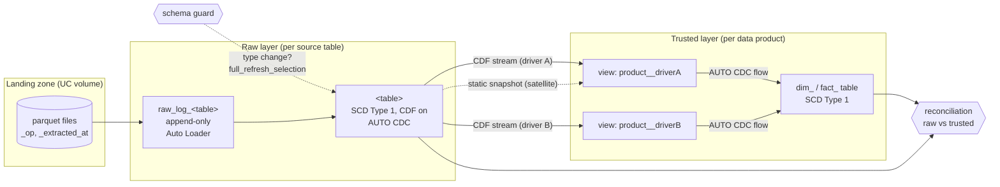
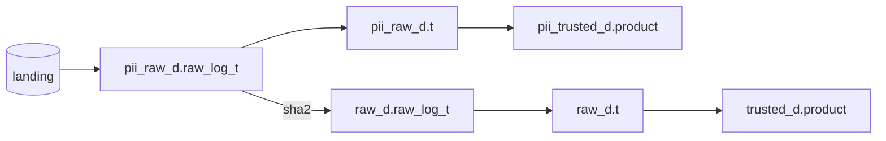

# Databricks Accelerator: config-driven Lakeflow Declarative Pipelines

One generic pipeline file. Every table comes from YAML. Developers write config
and small transform modules, never pipeline code.

This is the companion code for the talk **"Declarative Pipelines, Imperative
Problems"**: a generic, runnable reference implementation of the patterns in the
talk, with a fictional sample domain (products, customers, sales orders). It is
everything-serverless and runs on **Databricks Free Edition**.

## What's in it

| Pattern | Where |
|---|---|
| One pipeline file generated from YAML, with registries for domains, keys and PII | `src/pipeline.py`, `src/framework/engine.py`, `conf/*.yml` |
| Raw layer: Auto Loader into an append-only `raw_log_*`, then `AUTO CDC` into an SCD1 table with Change Data Feed | `engine.py` (`build_raw`) |
| Trusted layer: data-product modules with a fixed `transform(spark, schemas, key_registry)` contract | `src/data_products/` |
| Driver/satellite CDC: one AUTO CDC flow **per driver** into one target, satellites as static snapshots, no stream unions | `src/framework/cdc.py`, `engine.py` (`build_trusted`) |
| PII by design: declare `pii_columns`, get a vaulted and a public stream (native `sha2`, hashed once at the raw boundary) | `src/framework/pii.py`, `engine.py` |
| Schema-drift guard: detect column **type** changes before the run, `full_refresh_selection` for only the affected tables | `src/framework/schema_drift.py`, `src/jobs/schema_guard.py` |
| Data quality as raw-vs-trusted reconciliation (missing either side + value mismatch), YAML rules, parallel | `src/framework/reconciliation.py`, `src/jobs/reconcile.py`, `conf/reconciliation.yml` |
| Asset Bundle with `sandbox` / `dev` / `prod` targets | `databricks.yml`, `resources/` |
| Unit tests, including one that fails the build on any stream union | `tests/` |

## Architecture



With PII (shared targets only), each PII source gets a vaulted stream from
landing and a public stream that reads the vault and hashes the PII columns:



The scheduled job runs `schema_guard → pipeline → reconcile`.

## Quick start (Databricks Free Edition)

```bash
cd transformation
databricks auth login                                    # pick your workspace
databricks bundle deploy -t sandbox
databricks bundle run ldp_setup -t sandbox               # schemas + landing volume
databricks bundle run ldp_sample_data -t sandbox         # initial load files
databricks bundle run ldp_ingest -t sandbox              # guard -> pipeline -> reconcile

# then play:
databricks bundle run ldp_sample_data -t sandbox --params batch=changes
databricks bundle run ldp_ingest -t sandbox
databricks bundle run ldp_sample_data -t sandbox --params batch=type_drift
databricks bundle run ldp_ingest -t sandbox              # the guard refreshes sales_order_lines
```

`sandbox` puts every table in `workspace.sandbox_<you>` and builds no PII vault.
Use `-t dev` to see the shared layout (`raw_<domain>`, `trusted_<domain>`,
`pii_raw_<domain>`, `pii_trusted_<domain>`).

## Run the tests

```bash
cd transformation
pip install -e ".[dev]"     # or: uv run --with ... pytest
pytest
```

Pure-Python tests (config, naming, the full pipeline graph against a fake `dp`,
schema drift, the no-union rule) run anywhere. Spark-backed tests (PII masking,
filters, surrogate keys, reconciliation, every data product's transform) need
Java and are skipped without it. They run in CI (`.github/workflows/tests.yml`).

## Adding things

- **A source table:** add an entry to `conf/sources.yml`. That's it.
- **A data product:** add a module to `src/data_products/` (see its README for
  the contract) and an entry to `conf/data_products.yml`.
- **A reconciliation rule:** add it to `conf/reconciliation.yml`.

## Maps to the talk

| Talk section | Look at |
|---|---|
| One file, all config | `src/pipeline.py` (the whole thing is ~40 lines), `framework/engine.py`, `conf/` |
| The module contract | `src/data_products/README.md`, `dim_product.py` |
| Raw layer: Auto Loader + AUTO CDC + CDF | `engine.py` → `_register_raw_log_from_landing`, `_register_raw_scd1` |
| Drivers and satellites | `framework/cdc.py`, `dim_product.py` (two drivers), `fact_sales_order_line.py` (satellites) |
| PII by design | `conf/sources.yml` (`pii_columns`), `framework/pii.py`, `engine.build_raw` |
| Problem 1: a column changes type | `framework/schema_drift.py`, `jobs/schema_guard.py`, sample batch `type_drift` |
| Problem 2: stream-static joins | `fact_sales_order_line.py` docstring, sample batch `changes` (header date + category rename) |
| Problem 2b: never union streams | `tests/test_no_stream_unions.py`, `cdc.selected_driver` |
| Problem 3: expectations vs reconciliation | `framework/reconciliation.py`, `conf/reconciliation.yml` |

## Layout

```
transformation/
├── databricks.yml            bundle + targets (sandbox, dev, prod)
├── resources/
│   ├── pipeline.yml          the one serverless pipeline
│   └── jobs.yml              ldp_ingest, ldp_setup, ldp_sample_data
├── conf/
│   ├── sources.yml           raw layer
│   ├── data_products.yml     trusted layer
│   └── reconciliation.yml    data-quality rules
├── src/
│   ├── pipeline.py           the ONE pipeline source file
│   ├── framework/            engine, cdc, pii, keys, naming, schema_drift, reconciliation
│   ├── data_products/        dim_product, dim_customer, fact_sales_order_line
│   └── jobs/                 setup, generate_sample_data, schema_guard, reconcile
└── tests/
```

Open items: see [TODO.md](TODO.md).
